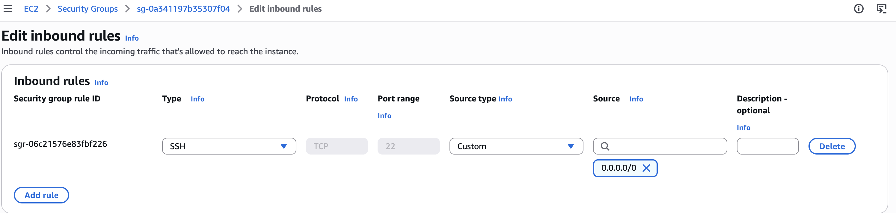
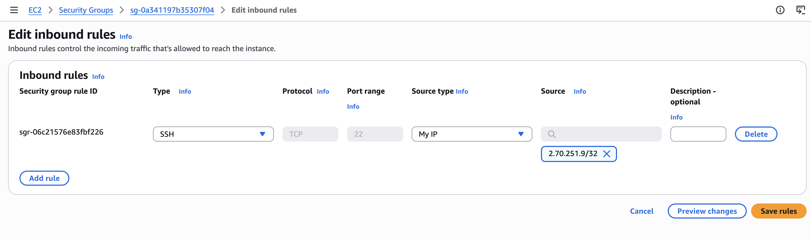

3. Your Security Group currently allows SSH from anywhere. Restrict it to your own IP only.

### Restrict SSH to my IP only

### Before


### Change
EC2 → instance → Security tab → security group → Edit inbound rules
→ SSH rule → Source: My IP → Save rules

### After


The source is now my public IP with `/32`, which means exactly one IP address.

### Test
SSH from my laptop still works:
```
ssh -i daws-92s ec2-user@18.60.212.15

From my phone's hotspot (different IP), SSH times out:
```
ssh -i daws-92s ec2-user@18.60.212.15
ssh: connect to host 18.60.212.15 port 22: Operation timed out
```

### Why restrict it if the private key is there anyway?
- bots scan and attack every open port 22
- a leaked key would work from anywhere
- an OpenSSH bug could be exploited before the key is even checked
- if password login is enabled, anyone could try passwords